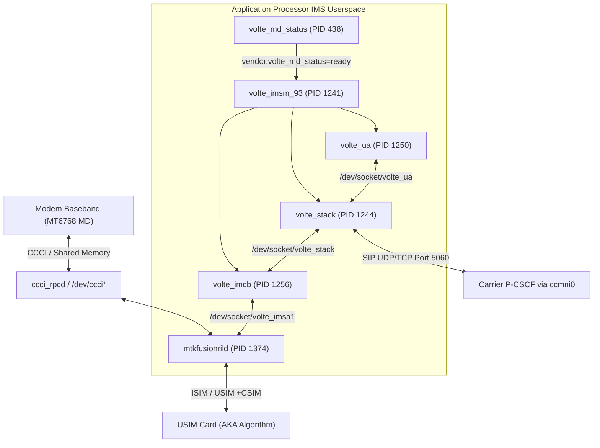
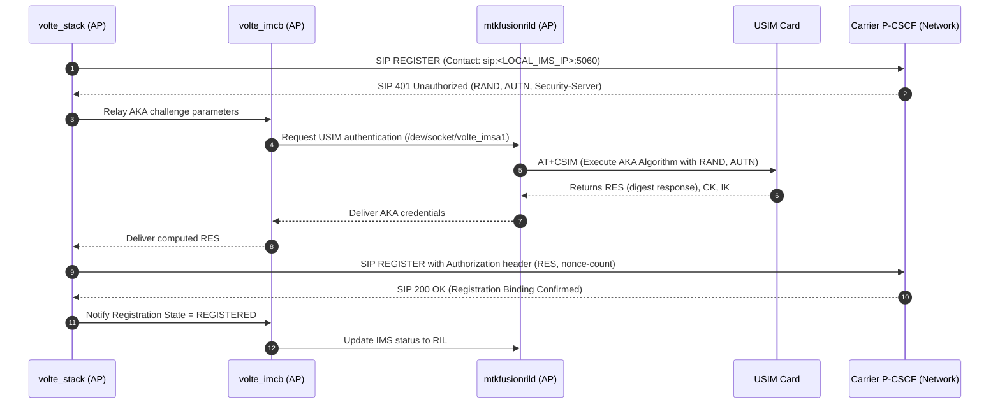

# Subsystem Deep Dive: VoLTE & IMS Architecture (MediaTek MT6768 / Merlinx)

## 1. Executive Summary

Voice over LTE (VoLTE) and IP Multimedia Subsystem (IMS) enablement is traditionally one of the most difficult hurdles in Sailfish OS porting. On Qualcomm platforms (such as Snapdragon 430 / `karatep`), VoLTE protocol handling is locked inside the proprietary Hexagon DSP modem baseband (AMSS) firmware, leaving developers powerless when vendor firmware rejects carrier SDP negotiations.

On the **MediaTek Helio G85 (MT6768 / `merlinx`)**, reverse engineering of the live Android reference environment reveals a fundamentally different, developer-accessible architecture: **the entire IMS/SIP stack runs in Linux userspace on the Application Processor (AP)**.

This document details the exact process topology, socket IPC protocols, kernel network routing rules, SIM AKA authentication sequence, and implementation blueprint required to achieve production-grade VoLTE on Sailfish OS for `merlinx`.

---

## 2. Comparative Architecture: MT6768 (Merlinx) vs. MSM8937 (Karatep)

The following table contrasts the architectural differences and explains why the failure modes encountered on `karatep` do not apply to `merlinx`:

| Feature / Subsystem | Qualcomm MSM8937 (`karatep`) | MediaTek Helio G85 (`merlinx`) |
| :--- | :--- | :--- |
| **SIP Engine Location** | Modem Hexagon DSP firmware (AMSS) | **AP Linux Userspace** (`/vendor/bin/volte_stack`) |
| **User Agent & Call Control** | Closed baseband QMI service | **AP Linux Userspace** (`/vendor/bin/volte_ua`) |
| **Session Management** | QMI IMSS / QMI Voice | **AP Linux Userspace** (`/vendor/bin/volte_imsm_93`) |
| **Vendor RIL** | `qcril` | `mtkfusionrild` (`libmtk-ril.so`) |
| **Modem IPC Mechanism** | SMD / QMI (`/dev/smdcntl*`, `rmnet_data*`) | CCCI / Linux network interfaces (`ccmni*`) |
| **IMS Cellular Interface** | `rmnet_data0` / multiplexed APN | **Dedicated interface `ccmni0`** (QCI 5, MTU 1300) |
| **P-CSCF Delivery** | QMI WDS Indication | 3GPP PCO in RIL response `SETUP_DATA_CALL` |
| **Failure Mode on Karatep** | Modem Hexagon DSP aborted on carrier answer SDP without running parser (`qipcallsdp.c` end cause 373). Unfixable on host. | **Not applicable.** SIP engine runs in host userspace with standard POSIX sockets. |
| **Registration Bug on Karatep** | `ofono-binder-plugin-ext-qti` invoked IMS test mode; parsed zeroed buffer as `REGISTERED`. | Uses standard MediaTek RIL request channels and Unix domain sockets (`/dev/socket/volte_imsa1`). |

---

## 3. Userspace Process Topology & Supervision

On `merlinx`, five cooperating daemons manage the IMS life cycle. They are managed by Android init scripts (`init.volte.rc` / `volte_imsm_93.rc`) gated on modem readiness:



### Active Daemons (Verified on Live Handset)
1. **`volte_md_status` (PID 438, user: `system`, group: `radio log system`)**:
   - Monitors modem state machine.
   - When baseband radio signals readiness, sets Android property `vendor.volte_md_status=ready`.
2. **`volte_imsm_93` (PID 1241, user: `system`, group: `radio cache inet misc log system wifi net_raw`)**:
   - VoLTE IMS Session Manager.
   - Supervises stack life cycle and configures bearer parameters.
   - Holds capabilities: `CAP_NET_RAW`, `CAP_NET_ADMIN`.
3. **`volte_stack` (PID 1244, user: `system`, group: `system log inet radio`)**:
   - The core SIP/SDP engine.
   - Dynamically links `/vendor/lib64/libvolte_core_shr.so` and `/vendor/lib64/libsip_core_shr.so`.
   - Owns the active network transport sockets (TCP/UDP port 5060) bound to `ccmni0`.
   - Identified in system properties via: `[vendor.net.ims.volte.pid]: [1244]`.
4. **`volte_ua` (PID 1250, user: `radio`, group: `system log inet radio net_admin`)**:
   - VoLTE User Agent.
   - Implements 3GPP TS 24.229 call session states, SDP offer/answer negotiation, session timer, AMR/AMR-WB audio codec configuration.
5. **`volte_imcb` (PID 1256, user: `system`, group: `system log inet radio`)**:
   - IMS Control Block.
   - Bridges control messages between `volte_stack`, `volte_ua`, and `mtkfusionrild`.

---

## 4. Dedicated Bearer `ccmni0` & Kernel Routing

Unlike consumer data traffic which routes over `ccmni1` (APN `default,supl`), IMS signaling and voice media run over a dedicated cellular bearer `ccmni0` (APN `ims`).

### Kernel Network Configuration (Live Verified)
* **Interface**: `ccmni0`
* **Protocol**: IPv4 (or IPv4v6 dual-stack)
* **MTU**: `1300` bytes (strictly enforced by carrier EPC to prevent IP packet fragmentation during encapsulation)
* **Quality of Service (QoS)**: QCI 5 (IMS Signaling), QCI 1 (Conversational Voice AMR-WB)

### Linux Policy Routing Table:
Linux policy routing isolates IMS signaling to table `1002`:

```text
# ip rule
0:      from all lookup local
999:    from all fwmark 0xc/0xffff lookup 2456
11000:  from all iif lo oif ccmni0 uidrange 0-0 lookup 1002
16000:  from all fwmark 0xd0065/0xdffff iif lo lookup 1002
17000:  from all fwmark 0xc0000/0xc0000 iif lo oif ccmni0 lookup 1002

# ip route show table 1002
default via <CARRIER_IMS_GATEWAY> dev ccmni0 proto static mtu 1300
<CARRIER_IMS_GATEWAY> dev ccmni0 proto static scope link
```

### Dynamic P-CSCF Discovery
The Proxy-Call Session Control Function (P-CSCF) IPv4 address is delivered by the network during initial LTE Attach or PDN Connectivity Request via **3GPP Protocol Configuration Options (PCO)** inside the RIL response for `SETUP_DATA_CALL`.
The Android Telephony framework parses the PCO and notifies the system:
```text
mPreciseDataConnectionStates:
  Pair{1 [ApnSettingV7] ims, APN: ims, type: ims}
    state: CONNECTED, transport: WWAN, id: 100, network type: LTE
    link properties: {
      InterfaceName: ccmni0,
      LinkAddresses: [ <LOCAL_IMS_IP>/32 ],
      DnsAddresses: [ /<CARRIER_DNS1>, /<CARRIER_DNS2> ],
      PcscfAddresses: [ /<CARRIER_PCSCF_IP> ],
      MTU: 1300,
      Routes: [ 0.0.0.0/0 -> <LOCAL_IMS_IP> ccmni0 mtu 1300 ]
    }
```

---

## 5. IPC & Unix Domain Socket Topology

Communication between the AP daemons uses abstract and filesystem UNIX domain sockets:

| Socket Path | Owner:Group | Mode | Protocol Role |
| :--- | :--- | :--- | :--- |
| `/dev/socket/volte_stack` | `system:system` | `0660` | Stream socket used by `volte_imcb` and `volte_ua` to send commands to the core SIP stack. Verified with 6 active connected clients. |
| `/dev/socket/volte_imsa1` | `system:radio` | `0660` | IMS Application Socket for SIM Slot 1. Relays SIM AKA authentication requests between `volte_imcb` and `mtkfusionrild`. |
| `/dev/socket/volte_imsa2` | `system:radio` | `0660` | IMS Application Socket for SIM Slot 2 (dual SIM). |
| `/dev/socket/volte_ua` | `system:system` | `0660` | User Agent IPC socket. Receives call trigger events (Dial, Answer, Hangup) from telephony framework. |
| `/dev/socket/volte_ut` | `system:radio` | `0660` | Supplementary Services over Ut interface (XCAP / HTTP query for call forwarding, barring). |
| `/dev/socket/volte_imsvt1` | `root:radio` | `0660` | Video Telephony (ViLTE) control stream. |

---

## 6. End-to-End IMS Registration Flow

MediaTek implements standard 3GPP TS 33.203 IMS AKA (Authentication and Key Agreement):



---

## 7. Voice Call & SMS Transport Mechanisms

### A. Voice Call Setup (MO - Mobile Originated)
1. **Trigger**: Ofono or Telephony UI requests dial on `ccmni0`.
2. **Offer**: `volte_ua` formats SIP `INVITE` with SDP:
   - `m=audio <PORT> RTP/AVP 100 101`
   - `a=rtpmap:100 AMR-WB/16000/1`
   - `a=fmtp:100 mode-change-capability=2; max-red=0`
   - `a=rtpmap:101 telephone-event/16000`
3. **Session Progress**: Network replies with `183 Session Progress` containing carrier answer SDP.
4. **Media Path**: The modem DSP activates dedicated bearer QCI 1 (conversational audio) and routes PCM audio directly to the MT6768 Audio DSP via the internal I2S/TDM bus. Audio does *not* route through userspace PulseAudio software mixing, ensuring sub-100ms latency.

### B. SMS over IMS
- SMS payloads are packaged into SIP `MESSAGE` transactions or 3GPP format `application/vnd.3gpp.sms` encapsulation.
- Delivered directly to `volte_stack` over UDP port 5060, confirmed with SIP `200 OK`.

---

## 8. Implementation Blueprint for Sailfish OS

To bring up VoLTE on Sailfish OS for `merlinx`:

### Step 1: Droid-HAL Init Supervision
Ensure the vendor init script `/vendor/etc/init/hw/init.volte.rc` (or equivalent) runs inside the `droid-hal` container:
- Property trigger: Set `persist.vendor.radio.volte_state=2` and `persist.vendor.mtk.volte.enable=2`.
- Trigger `vendor.volte_md_status=ready` once the cellular radio is registered.

### Step 2: Policy Routing & Network Provisioning
When `ofono` establishes the `ims` context on `ccmni0`:
1. Query PCO parameters (or configure static APN `ims`).
2. Bring up interface: `ip link set dev ccmni0 mtu 1300 up`.
3. Add routing table `1002`:
   ```bash
   ip route add default via <GATEWAY> dev ccmni0 table 1002 mtu 1300
   ip rule add from all iif lo oif ccmni0 lookup 1002
   ```

### Step 3: Ofono Binder Integration
- Utilize `ofono-ril-binder-plugin` targeting `android.hardware.radio@1.6::IRadio/slot1` and `slot2`.
- MediaTek proprietary RIL extensions are interfaced via `vendor.mediatek.hardware.mtkradioex@3.0::IMtkRadioEx/imsSlot1`.
- Ensure socket `/dev/socket/volte_imsa1` is readable/writable by `radio` user (`chmod 0660 /dev/socket/volte_imsa*`).

### Step 4: Verification Checklist
- [ ] Interface `ccmni0` is UP with valid carrier IP and MTU 1300.
- [ ] Daemons `volte_md_status`, `volte_imsm_93`, `volte_stack`, `volte_ua`, and `volte_imcb` are active in `ps -ef`.
- [ ] Property `vendor.net.ims.volte.pid` matches PID of `volte_stack`.
- [ ] `netstat -un` shows UDP port 5060 connected to carrier P-CSCF.
- [ ] `ofono` reports IMS registration active; test call remains on LTE without CSFB drop to 2G/3G.
